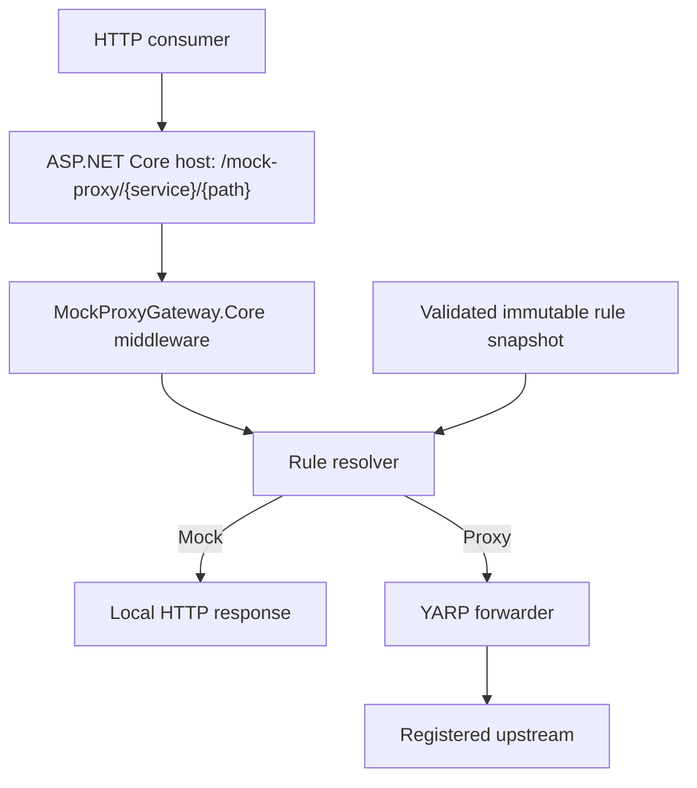

# MockProxyGateway

**Mock when needed. Proxy otherwise.**

MockProxyGateway is a proposed, lightweight, configuration-driven service virtualization gateway for .NET 10 and ASP.NET Core. Its goal is to let developers exercise real application flows even when external HTTP dependencies are unavailable, without replacing every integration with a mock or changing business logic.

> **Project status: design stage.** The initial implementation is tracked in [issue #1](https://github.com/ginmp8/MockProxyGateway/issues/1). The API, configuration contract, and commands below describe the intended first release. The runtime library, standalone host, tests, and NuGet package are not yet implemented or available. Examples are illustrative, not executed instructions for the current checkout.

## Why MockProxyGateway?

- Mock only the services, endpoints, or individual requests that need simulation.
- Return different responses from the same endpoint using headers, query parameters, JSON body fields, route parameters, cookies, and logical conditions.
- Proxy unmatched requests to explicitly configured real integrations.
- Enable, disable, or change rules without restarting the host.
- Embed the middleware in an existing ASP.NET Core application or run the same library as a dedicated gateway.
- Use a single reusable NuGet package, without mandatory authentication, authorization, database, cloud provider, or separate deployment.

## Architecture



The proposed solution has one reusable runtime assembly:

| Project | Responsibility |
| --- | --- |
| MockProxyGateway.Core | Middleware, configuration, matching, precedence, mock execution, YARP proxying, validation, reload, security safeguards, and diagnostics |
| MockProxyGateway.Host | Optional standalone ASP.NET Core application that consumes Core |
| MockProxyGateway.Tests | Unit and integration tests; not part of the runtime package |

Core is independent of the executable host, not of ASP.NET Core. All reusable functionality lives in one class library; consuming applications should need only the `MockProxyGateway` package or a reference to the Core project.

This middleware handles **incoming HTTP requests**. It does not automatically intercept outgoing HttpClient or Refit requests. Consumers can direct their integration base URLs to the gateway instead.

## Planned quick start

Prerequisites for the intended release: .NET 10 SDK, an ASP.NET Core application, an approved non-production environment, and valid host-owned rules.

Once the package has been built and made available through a trusted NuGet feed, add a reference to `MockProxyGateway`.

Register the library in the consuming application's `Program.cs`:

```csharp
var builder = WebApplication.CreateBuilder(args);

builder.Services.AddMockProxyGateway();

var app = builder.Build();

app.UseMockProxyGateway();

app.MapGet("/health", () => Results.Ok("Healthy"));

app.Run();
```

The default gateway route is:

```text
/mock-proxy/{service}/{remaining-path}
```

For example, `/mock-proxy/compliance/analysis` identifies service `compliance` and endpoint `/analysis`. The host's existing `/health` and other routes continue through their normal pipeline.

Use a different prefix if necessary:

```csharp
app.UseMockProxyGateway("/integration-gateway");
```

Installing the package or registering DI services alone does not activate gateway routes. Registering the middleware explicitly opts in; environment restrictions and the Enabled setting still apply.

## Configuration

### Operational settings: appsettings.json

The host owns operational settings. The optional `MockProxyGateway` section can be overridden using the host's usual configuration mechanisms, including environment-specific appsettings files.

```json
{
  "MockProxyGateway": {
    "Enabled": true,
    "Prefix": "/mock-proxy",
    "RuleSource": "File",
    "ConfigurationFile": "mock-proxy-gateway.json",
    "ReloadOnChange": true,
    "MaxBodySizeBytes": 1048576,
    "ProxyTimeoutSeconds": 30,
    "AllowedEnvironments": ["Development", "Staging"]
  }
}
```

These are illustrative operational settings, not measured performance recommendations. The timeout's exact semantics and supported limits are part of the implementation contract in issue #1.

### Rules: mock-proxy-gateway.json

Keep service destinations, matching conditions, and response definitions in a separate JSON document by default. The conventional path is relative to the consuming application's content root. A configured absolute path can be used for an externally mounted file.

The following minimal example demonstrates three independent outcomes for the same endpoint:

```json
{
  "schemaVersion": 1,
  "destinations": {
    "compliance-real": {
      "baseUrl": "https://compliance.example.test/"
    }
  },
  "services": {
    "compliance": {
      "enabled": true,
      "default": {
        "mode": "proxy",
        "destination": "compliance-real"
      },
      "endpoints": [
        {
          "method": "POST",
          "path": "/analysis",
          "rules": [
            {
              "id": "unavailable",
              "enabled": true,
              "priority": 900,
              "conditions": {
                "all": [
                  {
                    "source": "query",
                    "key": "simulate",
                    "operator": "equals",
                    "value": "unavailable"
                  }
                ]
              },
              "action": {
                "mode": "mock",
                "response": {
                  "statusCode": 503,
                  "body": { "error": "Service unavailable" }
                }
              }
            },
            {
              "id": "rejected",
              "enabled": true,
              "priority": 600,
              "conditions": {
                "all": [
                  {
                    "source": "body",
                    "key": "$.customer.riskScore",
                    "operator": "greaterThanOrEqual",
                    "value": 80
                  }
                ]
              },
              "action": {
                "mode": "mock",
                "response": {
                  "statusCode": 422,
                  "body": { "status": "Rejected" }
                }
              }
            },
            {
              "id": "success",
              "enabled": true,
              "priority": 400,
              "conditions": {
                "all": [
                  {
                    "source": "header",
                    "key": "X-Test-Scenario",
                    "operator": "equals",
                    "value": "success"
                  }
                ]
              },
              "action": {
                "mode": "mock",
                "response": {
                  "statusCode": 200,
                  "body": { "status": "Approved" }
                }
              }
            }
          ]
        }
      ]
    }
  }
}
```

All destination domains and test identifiers are synthetic. Replace the sample destination with an approved non-production upstream before exercising real forwarding.

### Example requests and expected outcomes

All rows refer to the example above and the same endpoint, `POST /mock-proxy/compliance/analysis`, with `Content-Type: application/json` and a valid JSON body.

| Request conditions | Expected behavior |
| --- | --- |
| X-Test-Scenario: success; customer.riskScore = 10 | Mock 200 Approved |
| customer.riskScore = 90 | Mock 422 Rejected |
| simulate=unavailable; customer.riskScore = 10 | Mock 503 Service unavailable |
| X-Test-Scenario: success; customer.riskScore = 90 | Mock 422; rejection has higher priority |
| X-Test-Scenario: success; simulate=unavailable; customer.riskScore = 90 | Mock 503; highest priority wins |
| No matching condition; customer.riskScore = 10 | Proxy to compliance-real /analysis |
| success rule disabled; X-Test-Scenario: success; customer.riskScore = 10 | Proxy to compliance-real /analysis |

Illustrative request, once an implementation is running on the selected local port:

```bash
curl -i http://localhost:5080/mock-proxy/compliance/analysis \
  -H 'Content-Type: application/json' \
  -H 'X-Test-Scenario: success' \
  -d '{"customer":{"riskScore":10}}'
```

Expected result: HTTP 200 with an Approved JSON response, without contacting the upstream.

See the [complete sample configuration](examples/mock-proxy-gateway.json) for additional scenarios: pending responses, delays, rate limiting, mock 401 responses, alternative upstreams, explicit proxy overrides, compound conditions, arrays, cookies, route parameters, disabled and expired rules, endpoint defaults, catch-all routes, and service-wide rules. The [implementation issue](https://github.com/ginmp8/MockProxyGateway/issues/1) retains the normative scenario matrix and acceptance criteria.

### Alternative configuration sources

The intended contract supports selecting one authoritative rule source per gateway instance:

| Source | Purpose |
| --- | --- |
| Dedicated JSON file | Default and recommended |
| Inline appsettings rules | Small configurations, when explicitly selected |
| Host-supplied IConfiguration | Integration with an existing configuration pipeline, preserving typed values |
| Programmatic C# configuration | Typed rule documents or custom providers |

Programmatic overrides take precedence over configured operational options, then library defaults fill omitted values. An explicit middleware prefix overrides the configured prefix. Rule sources are not implicitly merged; every source uses the same validation and snapshot mechanism.

## Request matching and precedence

An endpoint can contain multiple independently enabled rules, each with its own priority, conditions, and mock or proxy action.

| Match source | Example |
| --- | --- |
| Method and path | POST /analysis or GET /analysis/{id} |
| Header | X-Test-Scenario = success |
| Query string | simulate = unavailable |
| JSON body | $.customer.riskScore >= 80 |
| Route parameter | id = analysis-test-1001 |
| Cookie | test-session = session-b |
| Content type | application/json |

The planned matcher supports nested `all` (AND), `any` (OR), and `not` (NOT) groups, typed comparisons, existence and null checks, string operations, regular expressions, collection membership, numeric comparisons, and structural JSON equality. JSONPath supports nested properties and arrays. Multi-value conditions have explicit quantifiers.

Rule selection follows this hierarchy:

1. Resolve the service alias and select the best endpoint group by method and path specificity.
2. Evaluate enabled, unexpired endpoint rules. The highest matching priority wins.
3. If no endpoint rule matches, use the endpoint default action, when configured.
4. Otherwise evaluate matching service-wide rules, then use the service default.
5. If no action applies, return HTTP 404.

Exact routes take precedence over parameterized and catch-all routes according to the specified method/path matching rules. Equal highest-priority matching rules are an explicit configuration conflict, not a file-order tie-breaker.

Fallback means choosing a less-specific configured rule **before executing an action**. A failed mock, body-inspection error, or failed proxy must never silently trigger a real upstream call.

## Dynamic rule updates

The rule engine is designed to load and validate the selected configuration into an immutable in-memory snapshot. It should not read the JSON file for every request.

- Toggle a rule's `enabled` flag or edit its conditions, response, priority, or expiry.
- Publish valid rule changes atomically without restarting the host.
- Retain the last known good snapshot if a reload fails.
- Keep each in-flight request bound to one consistent configuration snapshot.

Operational options such as the gateway prefix, active source, and allowed environments are startup settings in the first release. Hot reload applies to rule documents, not to changing the application's registered middleware pipeline.

In Kubernetes, the dedicated file can be mounted independently through a ConfigMap volume. A ConfigMap mounted using `subPath` does not receive automatic updates. Volume propagation and file-change detection may introduce delays; cross-replica synchronization is not guaranteed by the initial release.

## Authentication, authorization, and safe deployment

MockProxyGateway is **authentication- and authorization-agnostic by design**. No JWT, OAuth, OpenID Connect, Identity, API key, authenticated principal, or named authorization policy is required by the library.

Existing hosts can optionally integrate their own authorization policies. The gateway must not change the host's identity configuration or bypass protections that apply to its branch. Upstream credential forwarding is independently controlled per destination.

The absence of mandatory authentication is not permission to expose an unrestricted public proxy. Use an approved non-production environment and appropriate host or infrastructure access controls.

The planned safety contract includes:

- Explicit opt-in and non-production activation restrictions.
- Registered, allowlisted destinations; no arbitrary target URLs supplied by clients.
- SSRF protection, bounded request inspection, regex/evaluation limits, and cancellation support.
- No automatic forwarding after a mock or evaluation failure.
- Per-destination credential controls and redacted diagnostics.
- Synthetic test data only.

## Technology and development

| Component | Planned technology |
| --- | --- |
| Runtime | .NET 10 / C# 14 / ASP.NET Core |
| Reverse proxy | [YARP](https://learn.microsoft.com/en-us/aspnet/core/fundamentals/servers/yarp/direct-forwarding?view=aspnetcore-10.0) |
| JSON matching | [JsonPath.Net](https://www.nuget.org/packages/JsonPath.Net), System.Text.Json |
| Matching engine | Declarative, typed C# rule engine |
| Build and dependency management | Directory.Build.props, Directory.Packages.props, global.json, NuGet lockfiles |
| Tests | xUnit, ASP.NET Core integration tests, local test upstream |
| Distribution | One NuGet package; optional standalone container host |

No additional runtime rules engine, WireMock instance, database, Redis, or cloud service is required for the planned first release.

The initial implementation, exact build and package conventions, dependency selection, runtime limits, security requirements, and verification gates are specified in [issue #1](https://github.com/ginmp8/MockProxyGateway/issues/1). The project is not yet ready to restore, build, test, or install from a published package.

## Scope and roadmap

The first release focuses on incoming HTTP middleware, declarative matching, mock responses, proxy forwarding, and dynamic rule configuration. Outgoing HttpClient interception, administrative interfaces, distributed rule synchronization, stateful sequences, recording/playback, and non-HTTP protocols are possible later work, not promised features.

## License

A repository license has not yet been selected. Do not assume a public repository grants a license to redistribute or reuse its contents.
