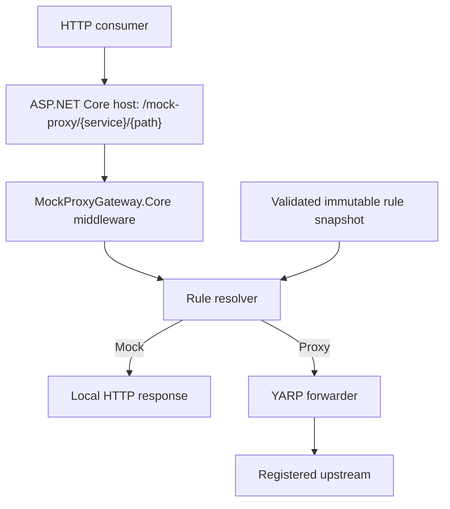

# MockProxyGateway

**Mock when needed. Proxy otherwise.**

MockProxyGateway is a lightweight, configuration-driven service virtualization gateway for .NET 10 and ASP.NET Core. Its goal is to let developers exercise real application flows even when external HTTP dependencies are unavailable, without replacing every integration with a mock or changing business logic.

> **Project status: development preview.** Follow [issue #1](https://github.com/ginmp8/MockProxyGateway/issues/1) and [draft PR #2](https://github.com/ginmp8/MockProxyGateway/pull/2). Core, the optional host, integration tests, schema and CI are implemented. [CI run 45949465199](https://github.com/ginmp8/MockProxyGateway/actions/runs/45949465199) verified 989 tests, package inspection, local-feed consumption (including optional host policies), the pinned example and standalone Docker on commit `59bbf98`. The PR checkpoint records current-HEAD acceptance. No public package has been published; this is a non-production test/integration tool.

## Why MockProxyGateway?

- Mock only the services, endpoints, or individual requests that need simulation.
- Return different responses from the same endpoint using headers, query parameters, JSON body fields, route parameters, cookies, and logical conditions.
- Proxy unmatched requests to explicitly configured real integrations.
- Enable, disable, or change rules without restarting the host.
- Embed the middleware in an existing ASP.NET Core application or run the same library as a dedicated gateway.
- Use a single reusable NuGet package, without mandatory authentication, authorization, database, cloud provider, or separate deployment.

## Architecture



The solution has one reusable runtime assembly:

| Project | Responsibility |
| --- | --- |
| MockProxyGateway.Core | Middleware, configuration, matching, precedence, mock execution, YARP proxying, validation, reload, security safeguards, and diagnostics |
| MockProxyGateway.Host | Optional standalone ASP.NET Core application that consumes Core |
| MockProxyGateway.Tests | Unit and integration tests; not part of the runtime package |

Core is independent of the executable host, not of ASP.NET Core. All reusable functionality lives in one class library; consuming applications should need only the `MockProxyGateway` package or a reference to the Core project.

This middleware handles **incoming HTTP requests**. It does not automatically intercept outgoing HttpClient or Refit requests. Consumers can direct their integration base URLs to the gateway instead.

## Quick start (development checkout)

Prerequisites: .NET 10 SDK, an ASP.NET Core application, an approved non-production environment, and valid host-owned rules.

Reference Core from source or build the package locally and consume it from a trusted local feed. Nothing is published by the build. After the Release build and pack steps below, run these commands from the consuming project's directory (replace the local feed path with the absolute path to this checkout's artifacts/packages):

```bash
dotnet add package MockProxyGateway --version 0.1.0-preview.1 --no-restore
dotnet restore --source /absolute/path/to/MockProxyGateway/artifacts/packages --source https://api.nuget.org/v3/index.json
```

The package is not available from a public feed. Use your organization's approved dependency source instead of nuget.org where required. The package contains only Core and declares its runtime dependencies.

Register the library in the consuming application's `Program.cs`:

```csharp
var builder = WebApplication.CreateBuilder(args);

builder.Services.AddMockProxyGateway();

var app = builder.Build();

app.UseMockProxyGateway();

app.MapGet("/health", () => Results.Ok("Healthy"));

app.Run();
```

The default gateway route is:

```text
/mock-proxy/{service}/{remaining-path}
```

For example, `/mock-proxy/compliance/analysis` identifies service `compliance` and endpoint `/analysis`. The host's existing `/health` and other routes continue through their normal pipeline.

Use a different prefix if necessary:

```csharp
app.UseMockProxyGateway("/integration-gateway");
```

Installing the package or registering DI services alone does not activate gateway routes. Registering the middleware explicitly opts in; environment restrictions and the Enabled setting still apply.

## Configuration

### Operational settings: appsettings.json

The host owns operational settings. The optional `MockProxyGateway` section can be overridden using the host's usual configuration mechanisms, including environment-specific appsettings files.

```json
{
  "MockProxyGateway": {
    "Enabled": true,
    "Prefix": "/mock-proxy",
    "RuleSource": "File",
    "ConfigurationFile": "mock-proxy-gateway.json",
    "ReloadOnChange": true,
    "MaxBodySizeBytes": 1048576,
    "ProxyTimeoutSeconds": 30,
    "AllowedEnvironments": ["Development", "Staging"]
  }
}
```

These are illustrative operational settings, not measured performance recommendations. `ProxyTimeoutSeconds` is YARP's activity timeout, not an overall deadline. Additional startup settings are `MaxConcurrentRequests` (64), `AuthorizationPolicy` (optional existing host policy), `FixtureRoot` (trusted directory), `AllowedDestinationAuthorities`, `AllowedDestinationAddresses` and `AllowLoopbackForTests` (false). Authority and IP lists are empty by default. A proxy destination must be explicitly approved; the sample `.test` domains cannot be forwarded without operator configuration.

### Rules: mock-proxy-gateway.json

Keep service destinations, matching conditions, and response definitions in a separate JSON document by default. The conventional path is relative to the consuming application's content root. A configured absolute path can be used for an externally mounted file.

The following minimal example demonstrates three independent outcomes for the same endpoint:

```json
{
  "schemaVersion": 1,
  "destinations": {
    "compliance-real": {
      "baseUrl": "https://compliance.example.test/"
    }
  },
  "services": {
    "compliance": {
      "enabled": true,
      "default": {
        "mode": "proxy",
        "destination": "compliance-real"
      },
      "endpoints": [
        {
          "method": "POST",
          "path": "/analysis",
          "rules": [
            {
              "id": "unavailable",
              "enabled": true,
              "priority": 900,
              "conditions": {
                "all": [
                  {
                    "source": "query",
                    "key": "simulate",
                    "operator": "equals",
                    "value": "unavailable"
                  }
                ]
              },
              "action": {
                "mode": "mock",
                "response": {
                  "statusCode": 503,
                  "body": { "error": "Service unavailable" }
                }
              }
            },
            {
              "id": "rejected",
              "enabled": true,
              "priority": 600,
              "conditions": {
                "all": [
                  {
                    "source": "body",
                    "key": "$.customer.riskScore",
                    "operator": "greaterThanOrEqual",
                    "value": 80
                  }
                ]
              },
              "action": {
                "mode": "mock",
                "response": {
                  "statusCode": 422,
                  "body": { "status": "Rejected" }
                }
              }
            },
            {
              "id": "success",
              "enabled": true,
              "priority": 400,
              "conditions": {
                "all": [
                  {
                    "source": "header",
                    "key": "X-Test-Scenario",
                    "operator": "equals",
                    "value": "success"
                  }
                ]
              },
              "action": {
                "mode": "mock",
                "response": {
                  "statusCode": 200,
                  "body": { "status": "Approved" }
                }
              }
            }
          ]
        }
      ]
    }
  }
}
```

All destination domains and test identifiers are synthetic. Replace the sample destination with an approved non-production upstream before exercising real forwarding.

### Example requests and expected outcomes

All rows refer to the example above and the same endpoint, `POST /mock-proxy/compliance/analysis`, with `Content-Type: application/json` and a valid JSON body.

| Request conditions | Expected behavior |
| --- | --- |
| X-Test-Scenario: success; customer.riskScore = 10 | Mock 200 Approved |
| customer.riskScore = 90 | Mock 422 Rejected |
| simulate=unavailable; customer.riskScore = 10 | Mock 503 Service unavailable |
| X-Test-Scenario: success; customer.riskScore = 90 | Mock 422; rejection has higher priority |
| X-Test-Scenario: success; simulate=unavailable; customer.riskScore = 90 | Mock 503; highest priority wins |
| No matching condition; customer.riskScore = 10 | Proxy to compliance-real /analysis |
| success rule disabled; X-Test-Scenario: success; customer.riskScore = 10 | Proxy to compliance-real /analysis |

Illustrative request, once the gateway is running with the example rules and approved local upstream destinations:

```bash
curl -i http://localhost:5080/mock-proxy/compliance/analysis \
  -H 'Content-Type: application/json' \
  -H 'X-Test-Scenario: success' \
  -d '{"customer":{"riskScore":10}}'
```

Expected result: HTTP 200 with an Approved JSON response, without contacting the upstream.

See the [complete sample configuration](examples/mock-proxy-gateway.json) for additional scenarios: pending responses, delays, rate limiting, mock 401 responses, alternative upstreams, explicit proxy overrides, compound conditions, arrays, cookies, route parameters, disabled and expired rules, endpoint defaults, catch-all routes, and service-wide rules. The [implementation issue](https://github.com/ginmp8/MockProxyGateway/issues/1) retains the normative scenario matrix and acceptance criteria.

### Alternative configuration sources

Select one authoritative rule source per gateway instance:

| Source | Purpose |
| --- | --- |
| Dedicated JSON file | Default and recommended |
| Inline appsettings rules | Small configurations, when explicitly selected |
| Host-supplied IConfiguration | Integration with an existing configuration pipeline, preserving typed values |
| Programmatic C# configuration | Typed rule documents or custom providers |

Use `RuleSource: File` for the dedicated file, `RuleSource: Inline` with `MockProxyGateway:Rules` in one complete JSON-file provider, or `RuleSource: Configuration` with `MockProxyGateway:RulesJson` containing the complete serialized rule document. Flattened multi-provider rules are rejected rather than coerced to strings. The `AddMockProxyGateway(IConfiguration)` overload accepts a scalar JSON document or a `RulesJson` entry; `AddMockProxyGateway(options => options.ProgrammaticRules = () => JsonElement.Parse(json))` supplies typed JSON directly (import `System.Text.Json`). Programmatic overrides take precedence over configured operational options, then library defaults fill omitted values. An explicit middleware prefix overrides the configured prefix. Rule sources are not implicitly merged; every source uses the same validation and snapshot mechanism.

## Request matching and precedence

An endpoint can contain multiple independently enabled rules, each with its own priority, conditions, and mock or proxy action.

| Match source | Example |
| --- | --- |
| Method and path | POST /analysis or GET /analysis/{id} |
| Header | X-Test-Scenario = success |
| Query string | simulate = unavailable |
| JSON body | $.customer.riskScore >= 80 |
| Route parameter | id = analysis-test-1001 |
| Cookie | test-session = session-b |
| Content type | application/json |

The matcher implements nested `all` (AND), `any` (OR), and `not` (NOT) groups, typed comparisons, existence and null checks, string operations, regular expressions, collection membership, numeric comparisons, and structural JSON equality. The bounded JSONPath subset supports property names, indices, wildcards, slices, unions (cumulative multiplicity at most four), up to two recursive descents and up to two outer filters, including filter unions. Filters support relative/root paths, singular comparisons, logical expressions, bounded `count()`/`value()` queries, and `length()` comparisons from singular queries or scalar literals to singular queries or scalar literals with Unicode scalar counting and Nothing semantics; a literal or singular query may also precede length in a comparison, and two bounded length calls can be compared. Length may also be compared with bounded count() or value() calls in either operand order (no predicate, union or descent in these arguments). One nested filter is supported, including within outer unions or alongside a second outer filter, without predicate unions or descent in nested-filter expressions. A root-driven enclosing query may be used for existence or count/value comparisons under cubic work and quadratic regex visit precharges; bounded length comparison operands (including root and candidate queries) are supported in either order. A single inner predicate, including ordinary comparisons or private functions, may refer to the original document root while the relative traversal starts at its outer candidate. Repeated traversal receives conservative pre-evaluation work charges. `match()` and `search()` support a bounded I-Regexp subset with singular queries or scalar-literal inputs, constant scalar pattern arguments (non-string arguments are false), Unicode-scalar dot, positive/negated scalar literal classes/ranges, and Unicode general-category escapes. Outer predicates may combine private functions and ordinary library predicates with bounded AND/OR/NOT and short-circuit evaluation. `length()`, `match()` and `search()` also accept `value()` over bounded non-overlapping relative/root queries (no predicate, union or descent within the argument). Exactly one selected node supplies a value; zero or multiple nodes supply Nothing. For regex functions `value()` support is limited to the input, not the pattern. One bounded `count()` or `length()` call may also be used as a length or regex argument; its numeric-or-Nothing result is folded to Nothing or logical false without runtime coercion, while the inner query is still validated and charged. A single nested relative existence filter can also combine private functions, with the same precharged work and regex budgets. A single nested private relative filter also supports count/value on either side of a comparison with a literal, singular relative query, or bounded relative `count()`/`value()` operand, preserving typed comparisons (including unlike-type count literals), structural equality and distinguishing Nothing from JSON null. Singular document-root comparison operands are supported in bounded nested count/value comparisons; bare non-singular operands, unsupported pattern constructs, deeper nesting and combinations exceeding safety limits are rejected. See [configuration and limits](docs/configuration.md) for the exact supported grammar. This is not unrestricted RFC 9535 coverage. Numeric range comparisons use exact decimal values. Multi-value conditions have explicit quantifiers.

Rule selection follows this hierarchy:

1. Resolve the service alias and select the best endpoint group by method and path specificity.
2. Evaluate enabled, unexpired endpoint rules. The highest matching priority wins.
3. If no endpoint rule matches, use the endpoint default action, when configured.
4. Otherwise evaluate matching service-wide rules, then use the service default.
5. If no action applies, return HTTP 404.

Exact routes take precedence over parameterized and catch-all routes according to the specified method/path matching rules. Equal highest-priority matching rules are an explicit configuration conflict, not a file-order tie-breaker.

Fallback means choosing a less-specific configured rule **before executing an action**. A failed mock, body-inspection error, or failed proxy must never silently trigger a real upstream call.

## Dynamic rule updates

The rule engine validates the selected configuration into an immutable in-memory snapshot and polls the selected rule source approximately once per second when reload is enabled. It does not read configuration files for each request. Fixture bytes are captured during compilation; update the rule document to trigger a fixture refresh.

- Toggle a rule's `enabled` flag or edit its conditions, response, priority, or expiry.
- Publish valid rule changes atomically without restarting the host.
- Retain the last known good snapshot if a reload fails.
- Keep each in-flight request bound to one consistent configuration snapshot.

Operational options such as the gateway prefix, active source, and allowed environments are startup settings in the first release. Hot reload applies to rule documents, not to changing the application's registered middleware pipeline.

In Kubernetes, the dedicated file can be mounted independently through a ConfigMap volume. A ConfigMap mounted using `subPath` does not receive automatic updates. Volume propagation and file-change detection may introduce delays; cross-replica synchronization is not guaranteed by the initial release.

## Authentication, authorization, and safe deployment

MockProxyGateway is **authentication- and authorization-agnostic by design**. No JWT, OAuth, OpenID Connect, Identity, API key, authenticated principal, or named authorization policy is required by the library.

Existing hosts can optionally integrate their own authorization policies. The gateway must not change the host's identity configuration or bypass protections that apply to its branch. All valid end-to-end request headers (including Authorization, Cookie, API keys and custom headers) are forwarded to the selected registered destination without header policy configuration.

The absence of mandatory authentication is not permission to expose an unrestricted public proxy. Use an approved non-production environment and appropriate host or infrastructure access controls.

The safety contract includes:

- Explicit opt-in and non-production activation restrictions.
- Registered, allowlisted destinations; no arbitrary target URLs supplied by clients.
- SSRF protection, bounded request inspection, regex/evaluation limits, and cancellation support.
- No automatic forwarding after a mock or evaluation failure.
- Transparent end-to-end header forwarding and redacted diagnostics.
- Synthetic test data only.

## Local development and verification

| Component | Technology |
| --- | --- |
| Runtime | .NET 10 / C# 14 / ASP.NET Core |
| Reverse proxy | [YARP](https://learn.microsoft.com/en-us/aspnet/core/fundamentals/servers/yarp/direct-forwarding?view=aspnetcore-10.0) |
| JSON matching | [JsonPath.Net](https://www.nuget.org/packages/JsonPath.Net), System.Text.Json |
| Matching engine | Declarative, typed C# rule engine |
| Build and dependency management | Directory.Build.props, Directory.Packages.props, global.json, NuGet lockfiles |
| Tests | xUnit, ASP.NET Core integration tests, local test upstream |
| Distribution | One NuGet package; optional standalone container host |

No additional runtime rules engine, WireMock instance, database, Redis, or cloud service is required.

The initial implementation, exact build and package conventions, dependency selection, runtime limits, security requirements, and verification gates are specified in [issue #1](https://github.com/ginmp8/MockProxyGateway/issues/1). The workflow runs locked restore, Release build, discovered-test enforcement, transitive dependency inspection, JSON Schema validation, packing, package-only consumer smoke, and standalone Docker smoke. Follow the draft PR for actual execution outcomes. No public NuGet package is published.

### Mock responses and trusted fixtures

A mock action accepts a status code (200–599), safe response headers, and an optional delay (0–60,000 ms). Specify at most one of JSON `body`, string `text`, or relative `bodyFile`. The host must set `FixtureRoot` for file responses. Keep that directory operator-controlled and read-only to untrusted users; traversal and symlink/reparse-point paths are rejected. No mock failure triggers a proxy fallback.

### Destination approval and optional authorization

Production activation is always rejected. In Development or Testing only, the operator may explicitly allow literal loopback HTTP upstreams for tests. Otherwise use HTTPS, explicitly approve every authority (host and non-default port) and the resolved IPs, and restrict network egress independently. All valid end-to-end request headers are forwarded, including credentials, scenario headers, `Forwarded` and `X-Forwarded-*`. The gateway does not filter or synthesize application headers; YARP handles protocol-specific headers and the outbound `Host` uses the registered destination authority. The gateway-owned HTTP handler disables automatic distributed-context injection so incoming trace headers pass through unchanged and absent trace headers are not populated from ambient host activities. Gateway correlation logging remains available; no host-wide tracing settings are changed. Only register destinations trusted to receive the full header set; upstreams must not trust client-supplied forwarded metadata as authenticated identity. Use `removeQuery` for explicit removal of simulation query controls. No header policy settings are required or supported. The gateway isolates its YARP forwarder's internal logger because the pinned forwarder logs full target URLs. Gateway completion/failure diagnostics emit only structured rule, service, action, status, version, duration, correlation and category fields. Existing host YARP services and logging configuration are unchanged. Configure host HTTP/transport tracing and any other instrumentation to avoid exposing sensitive URLs or request data. Set `AuthorizationPolicy` only if an existing host policy should protect the gateway; absent or denied policies fail closed. No authentication registration is required for policy-free local use.

### Verification commands

From the repository root (requires the pinned .NET SDK; Docker for the last command):

```bash
dotnet restore MockProxyGateway.sln --locked-mode
dotnet build MockProxyGateway.sln -c Release --no-restore
dotnet test MockProxyGateway.sln -c Release --no-build --no-restore
dotnet package list --vulnerable --include-transitive
dotnet pack src/MockProxyGateway.Core/MockProxyGateway.Core.csproj -c Release --no-build --no-restore -o artifacts/packages
bash scripts/package-smoke.sh
bash scripts/docker-smoke.sh
```

Use the [rule JSON Schema](docs/rules.schema.json) for structural validation and the [configuration and local usage reference](docs/configuration.md) for every setting, operator, safety boundary and runnable example. Run `bash scripts/example-scenarios.sh --verify` after building to exercise the pinned example with curl and a synthetic local upstream. The [acceptance trace](docs/acceptance-matrix.md) maps every normative scenario and AC to executable evidence. The runtime adds semantic checks beyond JSON Schema.

## Scope and roadmap

The first release focuses on incoming HTTP middleware, declarative matching, mock responses, proxy forwarding, and dynamic rule configuration. Outgoing HttpClient interception, administrative interfaces, distributed rule synchronization, stateful sequences, recording/playback, and non-HTTP protocols are possible later work, not promised features.

## License

MockProxyGateway is licensed under the [MIT License](LICENSE). See [third-party notices](THIRD-PARTY-NOTICES.md) for the exact runtime dependency license metadata.
